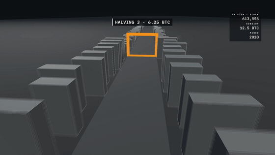
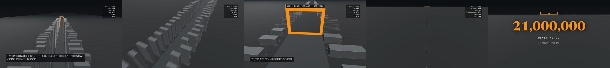

# worldfilm

**worldfilm** is a pipeline for making short films in code, where the film is a place the camera flies through
rather than a stack of animated layers. You build a world once (a city of data, a machine, a simulation, or real
footage with graphics placed in depth), film it with a camera whose energy is set like a brand decision, synthesize
the sound from the same event table the picture uses, and render a master with a real shutter. Before anyone calls
it finished, every render is measured: one-frame pops, loop seams, luminance, audibility of every sound cue, a
per-frame sweep that recomputes every number on screen, and fresh AI critics who see only the pixels.



It ships as an agent skill (`workflow/SKILL.md`, for Codex or Claude Code) plus the tools, templates and tests the
skill drives, and one complete example film, **Block Space**, that exercised every stage.

## Contents

- [How a film is made](#how-a-film-is-made)
- [The rules the pipeline enforces](#the-rules-the-pipeline-enforces)
- [The gates](#the-gates)
- [Requirements and install](#requirements-and-install)
- [Starting a film](#starting-a-film)
- [Repository layout](#repository-layout)
- [Tests](#tests)
- [The example: Block Space](#the-example-block-space)
- [Licences](#licences)

## How a film is made

A film is one world, one camera and one clock. Everything that moves is a pure function of time `t`, so any frame
can be rendered on its own, twice, on any machine, and come out the same.

```mermaid
flowchart LR
  S0["0 Intake<br/>brief, brand, motion system, facts"] --> S1["1 Reference lock<br/>measure references, styleframes"]
  S1 --> S2["2 Direction<br/>3 looks, 2 killed; shotspec.json"]
  S2 --> S3["3 World<br/>world.js built once"]
  S3 --> S4["4 Camera<br/>pose graph, dial, rest drift"]
  S4 --> S5["5 Timing<br/>beat grid, the silence"]
  S5 --> S6["6 Build<br/>HyperFrames, labels, sweep"]
  S6 --> S7["7 Draft gates"]
  S7 -- fail --> S6
  S7 --> S8["8 Sound<br/>synthesized from events, proven audible"]
  S8 --> S9["9 Master and critics<br/>Docker A/B, shutter, Gauntlet"]
  S9 -- one more pass --> S6
```



| stage | what happens | what it produces |
|---|---|---|
| 0 Intake | The brief, the brand tokens, the motion system (personality, eases, the camera dial, rest drift, label rules, aspect variants) and every fact that may appear on screen. | `BRIEF.md`, `brand.md`, `MOTION.md`, `facts.json` |
| 1 Reference lock | References are measured, never copied: palette, accents, line weight, grain, luminance, motion shape, cut rhythm. Styleframes are rendered with the real drawing code and compared side by side, with numbers. | `references/*.reference.json`, a compare sheet |
| 2 Direction | Three written looks, one styleframe each, two killed with a reason. One script (`tools/build.py`) compiles data, facts, the spec and the browser constants from a single source, so a number cannot drift between the label, the fact and the picture. | `DIRECTIONS.md`, `TREATMENT.md`, `shotspec.json` |
| 3 World | `world.js` lays out everything stateful once, at load (instanced geometry, typed arrays, seeded randomness, no clocks). `render(cam)` only moves the camera; `anchors(cam)` projects named world points to the screen for labels. Real footage enters as a SAM 2.1 cutout so graphics can sit between a person and the background. | `world.js`, `film/data.js` |
| 4 Camera | Each shot is a pose graph (position, look-at, field of view) interpolated with a monotone cubic, heights keyed in log space. The camera dial (1 Locked to 5 Perpetual) is set once. Rests drift on an ellipse so the camera is never still. A shot whose composition is a position on screen is solved from that target, not keyed by hand. | `film/camera.js` |
| 5 Timing | Voice first when there is one; a beat grid for the cuts; the drop placed on the key moment; one window of exact digital silence before the payoff. | the grid and the silence in the spec |
| 6 Build | A HyperFrames composition with one paused GSAP timeline; labels as DOM elements placed by one shared rule; every extra aspect ratio as its own composition; the per-frame sweep configured. | `index.html`, `compositions/`, `film/main.js`, `tools/sweep.mjs` |
| 7 Draft gates | A fast render without blur, then every gate below. A failure goes back to stage 6 before any critic sees the film. | `gates/draft-N/` |
| 8 Sound | A cue sheet generated from the picture's event table, synthesized in code (drone, kicks, risers, impacts), mastered to -14 LUFS, then every cue proven audible in the delivered file. The music-only version is mastered on its own. | `audio/cues.json`, mix, stems, music-only |
| 9 Master and critics | Two Docker renders that must decode frame-identical; a master with sub-frame motion blur; each aspect variant rendered and gated on its own; fresh critics in a loop until one says SHIP. | masters, poster, SRT, `GAUNTLET.jsonl` |

The full procedure, with every command, lives in [workflow/SKILL.md](workflow/SKILL.md). A new session reads the
project's `PROGRESS.md` first and resumes at the first unfinished stage.

## The rules the pipeline enforces

These began as mistakes found while making Block Space. Each one is now written as a requirement, and wherever
possible it is enforced by a check rather than by a sentence.

- **The world is built once.** No simulation step runs per frame; no timers, no `Date`, no unseeded randomness.
- **Money is integers.** Every number on screen is computed in the unit its source uses (satoshi, cents, blocks)
  and recomputed independently every frame by the sweep (BigInt, a different formula). A float rounding that the
  facts file shared with the picture survived eight critic rounds; the sweep would have caught it on the first draft.
- **The camera is never still at a rest.** Micro-drift moves on an ellipse (height in quadrature with the lateral
  sway), because a one-axis sine stops at every turning point and the frozen-time gate reads those instants as dead
  frames. The formula and its numbers live in the spec and are validated.
- **A framing target is solved and asserted.** "The ground's edge settles into the top fifth" is keyed every 0.1 s
  and the sweep asserts the projected position moves one way and then holds.
- **Labels follow one placement rule.** Above the anchor; beside the right post if that would cover the object;
  beside the left post if the right side belongs to the readout; inside the safe area; never in the caption zone;
  never past a hold line. The rule is one function (`film/place_label.js`) that the picture draws with and the sweep
  tests with, and no plate may touch the object it names in any frame.
- **A skipped gate is not a passed gate.** `check_gate_report.py` fails a report with an unexplained skip, and
  `doctor.sh` fails any build that hands the gate runner a path (a path with a space once skipped the contrast gate
  for a whole review cycle while every report read PASS).
- **Margin, not luck.** The frozen-time gate counts 10 fps samples, so one sample is 0.11 s per 30 s, and a blur
  master reads one sample apart from a draft. A draft passes only with two samples of margin.
- **Every aspect ratio is its own film.** A portrait cut gets its own composition, its own render and its own gates.
  Its wider vertical field once kept a solid gate bar on screen until the camera was over it, so the bar left the
  frame in a single frame (a pop). The portrait world now dissolves such objects on approach, and the 16:9 picture is
  proven unchanged by frame hashes.
- **Stems carry the mix's gain.** Any single-stem export (music only) is mastered on its own before muxing.
- **Nobody has heard the film until a person listens.** Every audio claim is a measurement; `PROGRESS.md` records who
  listened.

## The gates

| gate | catches | passes when | tool |
|---|---|---|---|
| frozen time | dead frames and holds | frozen samples <= 1.0 s per 30 s, longest hold <= the spec's limit, with two samples of margin | shotspec-film `run_gates.py` + `check_gate_report.py` |
| loudness | a mix that is too quiet, too loud or clipping | -14 LUFS +-1.5, true peak <= -1 dBTP | `run_gates.py` |
| facts | a number on screen that is not in `facts.json` | every numeric token traces to a fact | `run_gates.py` |
| beats | cuts that miss the music | every cut within 2 frames of its beat | `run_gates.py` |
| read time, contrast | text that cannot be read in time, low contrast, overlaps, clipping | per-text hold from character count; WCAG AA via `hyperframes check` | `run_gates.py` |
| pops | one-frame pops and flashes, globally and in a 16 px block grid; hard cuts never count | 0 pops, 0 flashes (single-frame thin-line "shimmer" is reported as a warning) | `detect_pops.py` |
| luma floor | a film that is a black tunnel on a phone | rolling luminance mean >= 35 | `luma_floor.py` |
| loop seam | a loop whose last frame does not flow into its first | seam within the loop's own position and velocity distribution | `loop_seam.py` |
| frame hash | an unintended change, or a non-deterministic renderer | decoded frames identical (or listed and explained) | `frame_hash.py` |
| audible | a sound cue that exists in the source but not in the mix | each cue +4 dB in its own band over the score (+6 for the hero hit), peak within +125/-45 ms of its event; silence windows below -60 dBFS | `prove_audible.py` |
| sweep | a wrong number, a label on its object, a target that reverses, something visible that should be gone | 0 violations over every frame, 0 unconfigured checks | `tools/sweep.mjs` on `sweep_lib.mjs` |
| spec | a spec that cannot be built | schema valid plus cross-checks (anchors, poses, framing keys, drift, silence, variants, gate command) | `validate_spec.py` |

After the gates, fresh critics (`claude -p --model opus` with read-only file access, or `codex exec`) receive only
the render's contact sheet, cut strips, gate reports, native stills, the brief and the previous critic's report. Each
round is appended to `GAUNTLET.jsonl`. Block Space converged in a recognisable shape: rounds 1-4 fixed structure,
5-8 fixed framing and label placement, 9 found a numeric error, 10 shipped. The skill budgets ten rounds.

## Requirements and install

worldfilm runs on macOS (tested on Apple silicon) and needs:

- Node 22 or later (via nvm) for the HyperFrames CLI, Playwright and three.js (`studio/package.json`)
- Python 3.13 with the packages in `studio/requirements.txt`, plus `studio/requirements-sam.txt` if you use real footage
- ffmpeg 8
- Docker, for pixel-identical masters (optional for drafts)
- the **shotspec-film** skill, which provides the base Shot Spec schema and the `run_gates.py` gate runner. Point the
  studio at it with `SHOTSPEC_HOME`, a symlink at `studio/kits/shotspec-film`, or an installed skill at
  `~/.codex/skills/shotspec-film` ([studio/kits/README.md](studio/kits/README.md))
- the `claude` or `codex` CLI, for the critic rounds

```bash
git clone https://github.com/nostitos/worldfilm.git && cd worldfilm
nvm install 22
(cd studio && npm ci && npx playwright install chromium)
uv venv --python 3.13 studio/.venv
uv pip install -r studio/requirements.txt --python studio/.venv/bin/python
ln -s /path/to/shotspec-film studio/kits/shotspec-film      # or export SHOTSPEC_HOME=...
bash studio/install-skill.sh                                # links workflow/ as ~/.codex/skills/worldfilm and ~/.claude/skills/worldfilm
source studio/env.sh
bash workflow/scripts/doctor.sh                             # READY, or a list of what is missing
bash workflow/tests/run.sh                                  # 19 checks against known defects
```

## Starting a film

```bash
bash studio/new-project.sh my-film
```

This copies [studio/projects/_template](studio/projects/_template): the brief, brand, motion system, progress table,
spec and facts templates, plus `build.sh`, `tools/build.py`, `tools/sweep.mjs`, `tools/srt.py`,
`audio/make_cues.py` and `film/place_label.js`. Fill in the brief, put references, data, footage and music in their
folders, then open the project in Codex or Claude Code and say *"use worldfilm on this brief"*. The agent works
through the stages, updates `PROGRESS.md` after each one, and stops for you at reference approval.

`build.sh` is the whole pipeline in order: compile, validate, static gates, sweep, cue sheet, mix, audibility,
music-only master, lint and check, two Docker renders with a frame-hash compare, the blur master, the muxed
masters, the gates on every delivered file, and every aspect variant rendered and gated on its own.
`DRAFT=1 bash build.sh` runs a fast local draft through the same gates. The sweep template exits with code 2 until
its checks are configured, so a placeholder can never pass.

## Repository layout

| path | contents |
|---|---|
| [workflow/SKILL.md](workflow/SKILL.md) | the skill: start here, the non-negotiables, stages 0-9, the script table, lessons |
| [workflow/schema/worldfilm.schema.json](workflow/schema/worldfilm.schema.json) | extends the Shot Spec with the camera dial and rest drift, pose graphs, framing targets, world anchors and label placement, aspect variants, blur, footage layers, audio cues and silence, gate settings |
| [workflow/scripts](workflow/scripts) | the gates and tools (`measure_reference.py`, `compare_frames.mjs`, `capture_subframes.mjs`, `detect_pops.py`, `loop_seam.py`, `frame_hash.py`, `luma_floor.py`, `check_gate_report.py`, `sweep_lib.mjs`, `synth_sfx.py`, `beats_drop.py`, `prove_audible.py`, `sam_separate.py`, `validate_spec.py`, `doctor.sh`) |
| [workflow/templates](workflow/templates) | project documents, `build.sh`, `sweep.template.mjs`, `film/place_label.js`, spec and facts templates |
| [workflow/tests](workflow/tests) | `run.sh`, synthetic clips with known defects, gate-report fixtures, the blur test page |
| [studio](studio) | `env.sh`, `new-project.sh`, `install-skill.sh`, `package.json`, Python requirements, `kits/` for the shotspec-film link, `projects/` |
| [studio/projects/block-space](studio/projects/block-space) | the example film: sources, spec, facts, world, camera, sound, gate reports, critic reports, ledger |

## Tests

`bash workflow/tests/run.sh` checks that every gate catches its own known defect and stays quiet on clean input:
a one-frame flash and a 40 px jump (pops), a loop stopped 4 px short (loop seam), an identical re-render and a
changed easing (frame hash), a skipped contrast gate and a frozen total with and without margin (gate reader),
fourteen synthetic defects for the sweep library plus Block Space's real functions (0 violations over 1,801
frames), the label placement rule, a sound cue 20 dB under the score and the same cue above it (audible), the
music-only mastering, and three broken specs. `--full` adds a Playwright capture of a test page with 1 and 4
sub-frames, which must soften moving edges and never blend across a hard cut. `doctor.sh` runs a subset as its
self-test. The test footage for `sam_separate.py` is a stock clip that is not redistributed here; see
[workflow/tests/README.md](workflow/tests/README.md).

## The example: Block Space



A 30-second film of the Bitcoin issuance schedule, 1920x1080 at 60 fps with a 1080x1920 cut. Every 2,016-block
difficulty period since 2009 is one concrete building on a night boulevard; its height is the block subsidy (50,
25, 12.5, 6.25, 3.125 BTC and on down, computed in integer satoshi exactly as Bitcoin Core does). The halvings are
orange gates, the present is a taller gate where the camera stops (block 970,440, October 2026, 20,095,128 coins
issued), the scheduled future is wireframe, and the street ends at block 6,929,999, where the subsidy reaches one
satoshi around 2140. Two seconds of digital silence, then the loudest moment of the film: **21,000,000**. The sound
is synthesized from the film's own event table: a kick on every halving, a tone at the present, accelerating ticks
for the future halvings, a riser into the silence.

The finished masters, poster and subtitles are attached to the
[block-space-v1 release](https://github.com/nostitos/worldfilm/releases/tag/block-space-v1); the project folder holds
everything needed to rebuild them (`bash build.sh`), every gate report for the delivered files
(`gates/master-*`), the ten critic reports (`gates/critic_r1.md` to `critic_r10.md`) and the ledger
(`GAUNTLET.jsonl`).

| delivered file | run_gates | pops | luma floor | sound |
|---|---|---|---|---|
| 1080p60, blur master + mix | 7 pass, **1 fail** (frozen time 1.11 s/30 s against 1.0), 2 skip | 0 pops, 1 shimmer frame | 52.3 | 15/15 cues audible, silence clean, -14.0 LUFS |
| 1080p60, music only | same picture: frozen time fails | 0 pops, 1 shimmer frame | 52.3 | -14.3 LUFS |
| 1080p60, Docker (no blur) + mix | 8 pass, 2 skip (frozen time 1.00) | 0 pops, 2 shimmer frames | 52.2 | 15/15 cues audible |
| 1080x1920, Docker + mix | 8 pass, 2 skip (frozen time 0.11) | 0 pops, 1 shimmer frame | 51.3 | same mix |

The two skipped gates (handoff, swatch) need a carried object or colour swatch points that this film does not
declare. Two Docker renders of the 16:9 picture decode identical in all 1,800 frames.

Known limits, stated plainly:

- **Nobody has listened to the soundtrack.** Every audio claim above is a measurement.
- **The 16:9 masters predate the rest-drift fix.** The elliptical drift was added to `film/camera.js` after they were
  rendered, so the blur master fails frozen time at 1.11 s per 30 s. A draft with the fix measures 0.78, and the
  portrait master, rendered after it, measures 0.11. `bash build.sh` regenerates the 16:9 masters with the fix.
- **The blur master is a local Playwright capture**, not a Docker-pinned render: the installed HyperFrames CLI
  (0.8.143) has no motion-blur option, so `capture_subframes.mjs` averages four sub-frames over a 180-degree shutter.
- The last critic's cosmetic note (the readout plate sits close to the horizon at 22.3-23.0 s) is unchanged.
- Draft renders, stills and contact sheets are not in the repository; the delivered files' reports are.

## Licences

Code adapted from other projects, and the libraries, fonts and source excerpts bundled with the example, are listed
with their licences in [THIRD_PARTY_NOTICES.md](THIRD_PARTY_NOTICES.md). No licence has been chosen yet for
worldfilm's own code.

